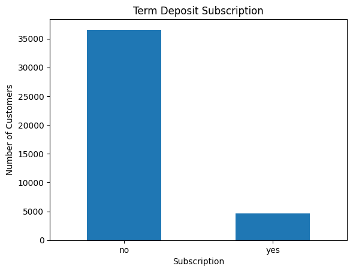
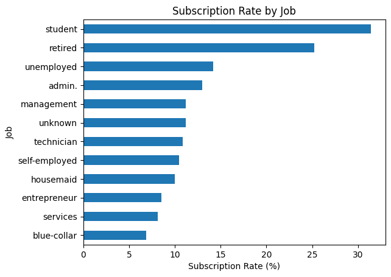

Python Classification Completed notebook

::: {.feature-band}
## 4.47× lift in the top 10%

The highest-scoring 10% of historical test records contained approximately **45% of all subscribers**. The practical question: how could a bank prioritise a limited campaign budget?

[Download the analysis notebook](../assets/bank-marketing.ipynb){.btn-primary-custom download="bank-marketing.ipynb"}
:::

## Question and data

Can customer information, campaign history, and economic indicators help identify records more likely to correspond to a term-deposit subscription?

The analysis uses **UCI Bank Marketing**, specifically `bank-additional-full.csv`: **41,188 records**, 20 input variables, and a binary subscription target. The data comes from a Portuguese banking institution’s campaigns between May 2008 and November 2010.

[Dataset and documentation](https://archive.ics.uci.edu/dataset/222/bank+marketing)

## Preparing the evidence

- Removed 12 exact duplicate copies, leaving **41,176 records**. Without customer IDs, identical rows cannot be proven to represent the same individual.
- Retained `unknown` as a categorical value rather than deleting large numbers of observations.
- Replaced the special `pdays = 999` code with a separate previous-contact indicator and a zero placeholder for days.
- Excluded **call duration**, which is unavailable before a call and would make targeting results unrealistic.

Only **11.27%** of remaining records were subscribers. Accuracy alone would therefore reward a model that mostly predicts non-subscription.

{width=640 fig-alt="Bar chart comparing 36,537 non-subscribers with 4,639 subscribers"}

## Modelling and evaluation

A stratified random split produced **26,352 training**, **6,588 validation**, and **8,236 test records**: approximately 64%, 16%, and 20% of the cleaned data.

I compared a majority-class baseline, logistic regression, decision trees, and random forests, including class-weighted variants. Numerical scaling was fitted on training data. Model selection and threshold tuning used validation data.

**Balanced logistic regression** was selected for the recall/F1 trade-off. A threshold of **0.64** maximised validation F1 within the tested range. The model and preprocessing were then refitted on the 80% development set before final holdout evaluation.

## Historical holdout results

| Metric | Final model |
|---|---:|
| Accuracy | 86.5% |
| Precision | 43.0% |
| Recall | 60.5% |
| F1 | 0.502 |
| ROC-AUC | 0.800 |
| Average precision | 0.447 |

The notebook labels average precision as “PR-AUC”; the reported value is calculated with `average_precision_score`.

The confusion matrix contains **561 true positives**, **744 false positives**, **367 false negatives**, and **6,564 true negatives**. At the selected threshold, the model identified about 60% of subscribers, with about 43% of positive predictions corresponding to subscribers.

## Ranking for a limited call budget

| Highest-scoring share | Test records selected | Subscribers captured | Lift versus random selection |
|---|---:|---:|---:|
| 10% | 824 | 44.7% | 4.470× |
| 20% | 1,648 | 64.4% | 3.220× |
| 30% | 2,471 | 73.1% | 2.435× |

Selecting the top 10% concentrated subscribers at roughly **50%**, compared with an overall test subscription rate of approximately **11.3%**. This is a retrospective ranking result, not a demonstrated increase in campaign revenue or a guaranteed future conversion rate.

## Findings and interpretation

Previous campaign history was a useful signal. Students and retired customers showed higher observed subscription rates than several other occupation groups, although group sizes differed. Contact channel, frequency, campaign timing, and economic conditions also contributed information.

{width=640 fig-alt="Occupation subscription rates: students about 31%, retired customers about 25%, blue-collar customers about 7%"}

These are predictive and descriptive relationships. They do not establish that changing occupation, contact channel, or call frequency would cause higher subscription.

## Limitations and next steps

- **Prediction timing:** removing duration addresses one major leakage risk. A strict pre-campaign model still needs an availability audit: `campaign` includes the current contact, and contact timing/channel must be known or planned at scoring time.
- **Time:** the random split mixes historical periods. A chronological evaluation is needed to assess generalisation to later campaigns.
- **Encoding:** dummy encoding was performed separately and aligned to training columns. A fitted encoder and pipeline would make reference categories and handling of unseen categories more robust.
- **Calibration:** class-weighted model scores should not automatically be read as real-world probabilities. The 0.64 cutoff is a decision threshold, not a guaranteed 64% likelihood.
- **Business value:** call costs, deposit value, uncertainty, and prospective testing are needed before recommending deployment.
- **Scope:** these are older records from one banking setting. Results have not been validated on current or Nigerian banking data.

## Reproduce the analysis

Download the notebook and obtain `bank-additional-full.csv` from the UCI dataset. Put the CSV beside the notebook. The analysis uses Python, Pandas, NumPy, Matplotlib, scikit-learn, and Jupyter.

The metrics above are transcribed from the supplied notebook’s saved outputs. They have not been independently rerun for this website. The original notebook is provided unchanged.

[Notebook](../assets/bank-marketing.ipynb) · [Dataset](https://archive.ics.uci.edu/dataset/222/bank+marketing) · [My GitHub profile](https://github.com/Nicholasmile)
